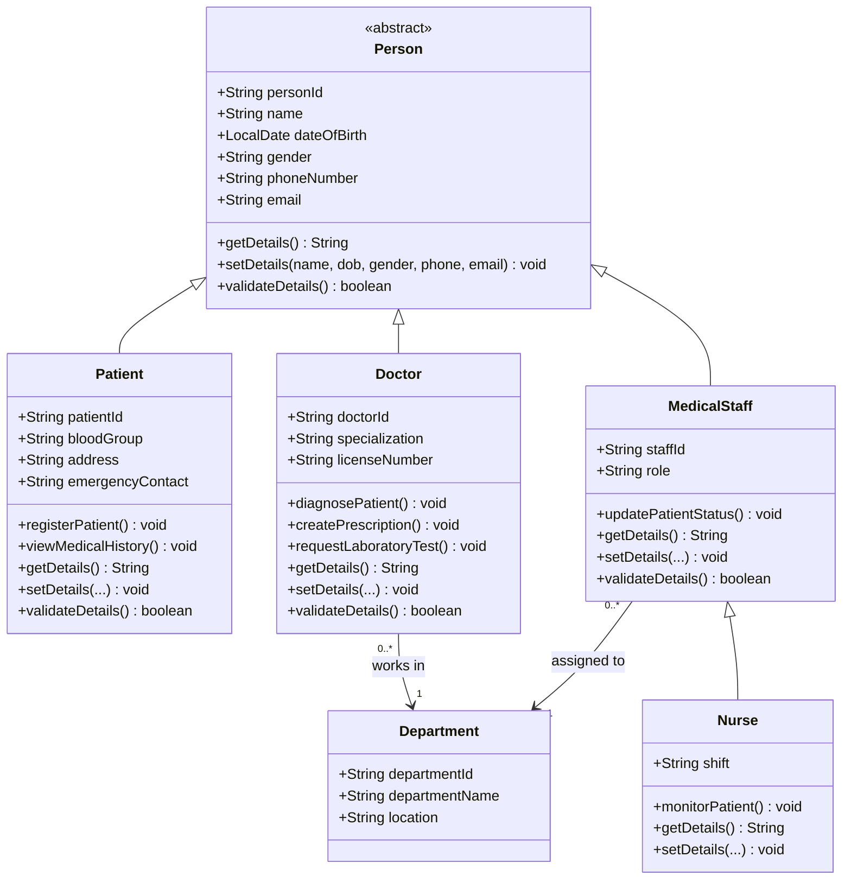
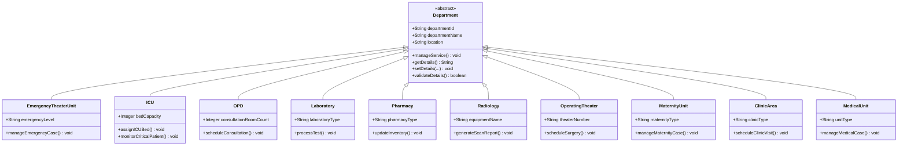
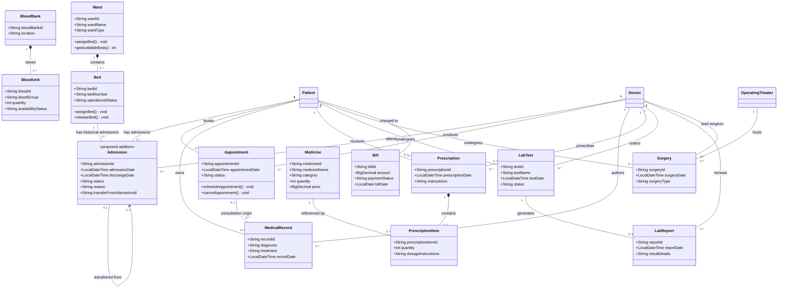

# MediTek — 02. Domain Model Architecture

## 1. Domain Model Overview

The MediTek domain model represents the core operational entities, clinical interactions, and physical facilities of a modern hospital. It is based on the project proposal class diagrams (Figures 1, 2, and 3). Technical additions, type deviations, and interpreted relationships are explicitly documented.

---

## 2. Core Class Hierarchies (Inheritance)

### 2.1 Person Hierarchy (Figure 1)

The `Person` hierarchy models human actors in the hospital using inheritance to minimize duplication of demographic data.

**Person subtype constraint:** Every concrete `Person` belongs to exactly one direct subtype: `Patient`, `Doctor`, or `MedicalStaff`. `Nurse` is a further subtype of `MedicalStaff`; it is not a separate, mutually exclusive direct subtype of `Person`. The subtype constraint is an application/database design invariant and is not fully expressed by the class diagram.

**Responsibilities:**

- **`Person` (abstract):** Encapsulates shared demographic identity and validation logic. `validateDetails()` checks that the name is non-blank, the email has a valid format when supplied, and the phone number follows the project's agreed validation rule.
- **`Patient`:** Represents individuals receiving medical care. Contains clinical blood group classification and emergency contact information.
- **`Doctor`:** Represents licensed medical practitioners authorized to diagnose patients, prescribe medications, schedule surgeries, and order laboratory tests.
- **`MedicalStaff`:** Represents clinical and administrative staff members assigned to hospital departments.
- **`Nurse`:** Extends `MedicalStaff` to represent inpatient care providers assigned to shift rotations (`Morning`, `Evening`, `Night`).

**Department assignment note:** `Doctor` and `MedicalStaff` each have one required department association in this model. The relationship is represented by the association to `Department`; a separate `departmentId` attribute is therefore not repeated in these class definitions. If staff members may belong to multiple departments, that requirement must be decided before database design.

---

### 2.2 Department Hierarchy (Figure 1)

The Department hierarchy models distinct clinical and administrative divisions of the hospital.

**Department subtype constraint:** Each concrete `Department` instance belongs to exactly one of the ten subtypes: `EmergencyTheaterUnit`, `ICU`, `OPD`, `Laboratory`, `Pharmacy`, `Radiology`, `OperatingTheater`, `MaternityUnit`, `ClinicArea`, or `MedicalUnit`. Each subtype instance maps to exactly one parent `Department`. This is an application/database invariant; the ER diagram's individual parent-child relationships do not, by themselves, enforce that a parent belongs to exactly one subtype.

---

## 3. Hospital Operations & Resources

The following class diagram describes operational entities and their associations. Historical records are retained; active-state rules are documented separately from historical relationship cardinalities.

**Bed operational-state rule:**

- The persisted `Bed.operationalStatus` is limited to `AVAILABLE`, `MAINTENANCE`, or `UNAVAILABLE`.
- If an active admission exists for a bed, its displayed state is `OCCUPIED`.
- If no active admission exists, its displayed state equals its persisted operational status.
- A bed is assignable only when it has no active admission and its persisted operational status is `AVAILABLE`.
- Discharge and transfer must never overwrite the persisted operational status.
- A bed may have zero or many historical admissions, but it must have no more than one active admission at a time. This active-admission constraint is separate from the historical one-to-many relationship shown in the diagram.

**Admission transfer rule:** A transfer closes the source admission and creates a new admission for the destination bed. `transferFromAdmissionId` identifies the immediately preceding admission, when the admission resulted from a transfer. The referenced admission must exist, and an admission must not reference itself. A transfer must not leave two active admissions for the same patient or bed.

**Prescription rule:** Each prescription contains at least one prescription item. Each item references exactly one medicine. A medicine may be referenced by zero or many prescription items. The `Medicine.quantity` field represents the inventory quantity maintained by the pharmacy; the unit of measure and stock-adjustment rules must be specified in the inventory design.

**Blood inventory note:** `BloodUnit.quantity` is treated as an inventory count in this model. The unit represented by that count (for example, bags or another defined stock unit) must be standardized in the inventory requirements before implementation.

**Laboratory report rule:** A lab test may have no report yet or one report. Each report belongs to exactly one lab test. The ordering doctor and reviewing doctor may be different people; this model treats the `LabTest` ordering association and `LabReport` reviewing association as separate roles.

---

## 4. Entity-Relationship (ER) Data Model

The ER diagram below represents the principal persistence relationships. Subtype exclusivity, active-admission constraints, and other cross-row rules are documented after the diagram because basic ER cardinalities do not express all of those constraints.

```mermaid
erDiagram
    PERSONS ||--o| PATIENTS : "specializes to"
    PERSONS ||--o| DOCTORS : "specializes to"
    PERSONS ||--o| MEDICAL_STAFF : "specializes to"
    MEDICAL_STAFF ||--o| NURSES : "specializes to"
    PERSONS o|--o| USER_ACCOUNTS : "has optional credentials"

    DEPARTMENTS ||--o{ DOCTORS : "employs"
    DEPARTMENTS ||--o{ MEDICAL_STAFF : "employs"

    DEPARTMENTS ||--o| EMERGENCY_THEATER_UNITS : "specializes to"
    DEPARTMENTS ||--o| ICUS : "specializes to"
    DEPARTMENTS ||--o| OPDS : "specializes to"
    DEPARTMENTS ||--o| LABORATORIES : "specializes to"
    DEPARTMENTS ||--o| PHARMACIES : "specializes to"
    DEPARTMENTS ||--o| RADIOLOGIES : "specializes to"
    DEPARTMENTS ||--o| OPERATING_THEATERS : "specializes to"
    DEPARTMENTS ||--o| MATERNITY_UNITS : "specializes to"
    DEPARTMENTS ||--o| CLINIC_AREAS : "specializes to"
    DEPARTMENTS ||--o| MEDICAL_UNITS : "specializes to"

    WARDS ||--o{ BEDS : "contains"
    BEDS ||--o{ ADMISSIONS : "has historical admissions"
    PATIENTS ||--o{ ADMISSIONS : "has admissions"
    DOCTORS ||--o{ ADMISSIONS : "attends"
    ADMISSIONS o|--o| ADMISSIONS : "transferred from"

    PATIENTS ||--o{ APPOINTMENTS : "schedules"
    DOCTORS ||--o{ APPOINTMENTS : "attends"

    PATIENTS ||--o{ MEDICAL_RECORDS : "history for"
    DOCTORS ||--o{ MEDICAL_RECORDS : "authored by"
    APPOINTMENTS o|--o{ MEDICAL_RECORDS : "originates from"

    PATIENTS ||--o{ PRESCRIPTIONS : "issued to"
    DOCTORS ||--o{ PRESCRIPTIONS : "authored by"
    PRESCRIPTIONS ||--|{ PRESCRIPTION_ITEMS : "contains"
    MEDICINES ||--o{ PRESCRIPTION_ITEMS : "referenced in"

    PATIENTS ||--o{ LAB_TESTS : "ordered for"
    DOCTORS ||--o{ LAB_TESTS : "ordered by"
    LAB_TESTS ||--o| LAB_REPORTS : "generates"
    DOCTORS ||--o{ LAB_REPORTS : "reviews"

    OPERATING_THEATERS ||--o{ SURGERIES : "hosts"
    DOCTORS ||--o{ SURGERIES : "lead surgeon"
    PATIENTS ||--o{ SURGERIES : "patient for"

    BLOOD_BANKS ||--o{ BLOOD_UNITS : "maintains"
    PATIENTS ||--o{ BILLS : "billed to"
```

**ER relationship and constraint notes:**

1. **Person subtypes:** Each `Person` must belong to exactly one direct subtype (`Patient`, `Doctor`, or `MedicalStaff`). A `Nurse` is a subtype of `MedicalStaff`. Each subtype row maps to one parent `Person`. The `o|` notation above allows a parent row to have zero or one row in each subtype table; the additional rule that it must have exactly one direct subtype is enforced by application/database constraints.
2. **Department subtypes:** Each concrete `Department` must belong to exactly one of the ten subtype tables. Each subtype row maps to exactly one parent `Department`. The ER relationships show the individual parent-child mappings; they do not alone enforce the collective exactly-one-subtype rule.
3. **User accounts:** The `Person` ↔ `UserAccount` relationship is optional one-to-one on both sides. A `UserAccount` may reference one `Person`, and a `Person` may have at most one linked `UserAccount`. Unlinked administrative/service accounts are allowed only if authorized by the system's account policy.
4. **Ward and bed:** A ward may contain zero or many beds; each bed belongs to exactly one ward.
5. **Admissions:** Each admission belongs to exactly one bed, one patient, and one attending doctor. A bed, patient, or doctor may be associated with zero or many historical admissions. The database/application must enforce no more than one active admission per bed and no more than one active admission per patient.
6. **Admission transfer:** The self-relationship records the preceding admission for a transfer. The source admission is optional for an admission that is not a transfer. A transferred admission references at most one predecessor; a predecessor may be referenced by zero or many later admissions only if branching transfers are permitted by the business rules. If branching is not permitted, enforce at most one successor.
7. **Appointments and medical records:** An appointment may be associated with zero or many medical records. A medical record may originate from zero or one appointment.
8. **Prescription items:** Each prescription has one or more items. Each item references exactly one medicine; a medicine may be referenced by zero or many items.
9. **Laboratory reports:** A lab test may generate zero or one report. Each report belongs to exactly one lab test. The doctor who orders a test and the doctor who reviews its report are represented as separate associations.
10. **Blood inventory:** A blood bank may contain zero or many blood-unit inventory records. Each blood-unit record belongs to exactly one blood bank.

---

## 5. Explicitly Labelled Technical Additions, Deviations & Interpretations

### 5.1 Proposed Technical Additions (Not in Original UML)

1. **`Admission` entity:**
   - **Rationale:** Essential for hospital resource tracking. In UML Figure 3, `Ward` contains `Bed`, but there is no mechanism linking a patient to a bed across time. `Admission` records active occupancy, transfer history, and discharge timestamps.
2. **`UserAccount` entity:**
   - **Rationale:** Required to store authentication credentials (`username`, `email`, BCrypt `passwordHash`) and system authority (`role`). It is linked optionally to `Person`, subject to the account policy described above.
3. **Patient association on `Surgery`:**
   - **Rationale:** UML Figure 2 depicts `Surgery` linked to `Doctor` and `OperatingTheater`, but omits the patient association. A surgery cannot be performed without a patient.
4. **`PrescriptionItem` entity:**
   - **Rationale:** Provides an explicit association entity between `Prescription` and `Medicine`, allowing each prescribed medicine to have its own quantity and dosage instructions.

### 5.2 Documented Type Deviations

1. **Integer types for capacities:**
   - In UML Figure 1, `ICU.bedCapacity` and `OPD.consultationRoomCount` are defined as `String`. In this design, they are specified as `Integer` to support numeric arithmetic, validation, and relational constraints.
2. **Date/time types:**
   - Date-only values use `LocalDate`; timestamps use `LocalDateTime`. This replaces the original generic `String` date fields where a date or timestamp is required. The system-wide timezone and timestamp-storage policy must be defined consistently before implementation.
3. **Monetary values:**
   - Monetary amounts and prices use `BigDecimal` rather than floating-point types to avoid binary floating-point rounding errors.

### 5.3 Documented Typographical & Scope Corrections

1. **Typographical corrections:** `processTesst()` and `prcessTest()` are corrected to `processTest()`.
2. **Pharmacy scope:** UML Figure 1 lists `processTest()` under `Pharmacy`. This operation is removed from `Pharmacy` because laboratory tests are processed by `Laboratory`. `Pharmacy` manages medicine stock, dispensing, and inventory.
3. **Unified `OperatingTheater` class:** In Figure 1, `OperatingTheater` extends `Department`, while Figure 2 depicts `OperatingTheater` with `theaterId` and `theaterNumber`. These are unified into a single entity extending `Department`, with `theaterNumber` represented as its subtype-specific attribute. The identifier is inherited from `Department`.

### 5.4 Interpreted Associations

1. **Doctor – Surgery:** The association is interpreted as the lead-surgeon relationship. Each surgery has one lead surgeon; a doctor may lead zero or many surgeries.
2. **Doctor – LabTest and LabReport:** The `LabTest` association identifies the ordering doctor. The `LabReport` association identifies the reviewing doctor. These roles may be held by different doctors.
3. **MedicalRecord – Patient and Doctor:** A medical record belongs to one patient and is authored by one doctor. Its association with an appointment is optional and records the consultation origin.
4. **Doctor/MedicalStaff – Department:** Each doctor and medical staff member is assigned to one department in this model. This is represented by an association rather than a duplicate `departmentId` attribute in the class diagram.

---

## 6. Open Design Decisions Requiring Confirmation

The following details are not fully determined by the current domain model and must be confirmed before implementation:

1. **Department assignment:** Can a doctor or medical staff member belong to more than one department, or is exactly one department required?
2. **Admission transfer branching:** Can one admission be the predecessor of more than one later admission? If not, enforce at most one successor.
3. **Medicine inventory unit:** What unit does `Medicine.quantity` represent, and how are dispensing, returns, expiry, and stock adjustments recorded?
4. **Blood inventory unit:** Does `BloodUnit.quantity` represent bags, components, volume, or another defined stock unit?
5. **Account policy:** Are unlinked administrative/service accounts permitted, and which roles may use them?
6. **Date/time policy:** Which hospital timezone governs `LocalDateTime` values, and should timestamps be stored using a timezone-aware convention such as `Instant` instead?

These decisions should be resolved in the relevant requirements/design documents before implementation. No behavior beyond the explicitly stated rules should be assumed.
