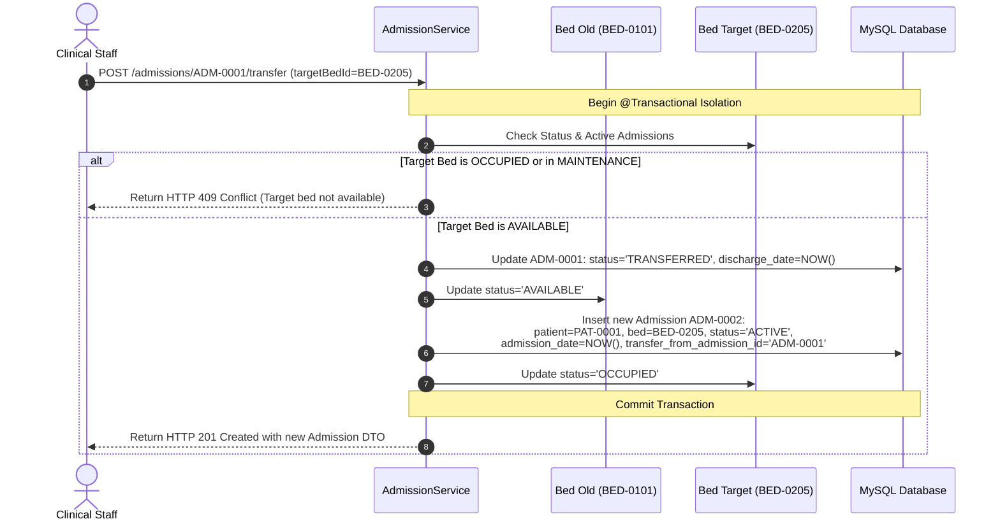

# MediTek — 05. Business Rules and Validation Specifications

## 1. DTO & Input Field Validation Constraints

The future Spring Boot backend must enforce bean validation (`jakarta.validation.constraints`) on all incoming request DTOs. The frontend must implement corresponding client-side validation to provide immediate user feedback.

| Field / Property | Module | Type & Constraints | Error Message / Validation Rule |
| :--- | :--- | :--- | :--- |
| `name` | Person / Patient / Doctor | `@NotBlank`, length: 3–128 | "Full name is required (3–128 characters)." |
| `dateOfBirth` | Person / Patient | `@NotNull`, `@Past` | "Date of birth must be a valid past date." |
| `gender` | Person | `@NotNull`, enum: `MALE`, `FEMALE`, `OTHER` | "Gender must be specified." |
| `phoneNumber` | Person | `@NotBlank`, regex: `^0[0-9]{9}$` | "Phone number must be a valid 10-digit number starting with 0." |
| `email` | Person / UserAccount | `@NotBlank`, `@Email`, length: 5–128 | "Must be a well-formed email address." |
| `bloodGroup` | Patient / BloodUnit | `@NotNull`, regex: `^(A\|B\|AB\|O)[+-]$` | "Valid blood group required (A+, O+, B+, AB+, A-, O-, B-, AB-)." |
| `licenseNumber` | Doctor | `@NotBlank`, unique, length: 5–64 | "Official medical license number is required." |
| `bedCapacity` | ICU (Department) | `@NotNull`, `@Min(1)`, `@Max(500)` | "ICU bed capacity must be a positive integer." |
| `consultationRoomCount`| OPD (Department) | `@NotNull`, `@Min(1)`, `@Max(200)` | "OPD consultation room count must be a positive integer." |
| `quantity` | Medicine / BloodUnit | `@NotNull`, `@Min(0)` | "Quantity cannot be negative." |
| `price` | Medicine / Bill | `@NotNull`, `@DecimalMin("0.00")` | "Monetary amounts cannot be negative." |
| `appointmentDate` | Appointment | `@NotNull`, `@Future` (for booking) | "Appointment date must be scheduled in the future." |

---

## 2. Inpatient Ward & Bed Availability State Machine

### 2.1 Bed Statuses & Occupancy Source of Truth
Beds support four distinct operational states:
1. **`AVAILABLE`**: The bed is physically clean, operational, and unoccupied. Ready for immediate patient assignment.
2. **`OCCUPIED`**: The bed is currently allocated to an inpatient with an active admission (`status = 'ACTIVE'`).
3. **`MAINTENANCE`**: The bed is undergoing sanitization, physical repairs, or medical gas maintenance. It cannot be assigned to any patient.
4. **`UNAVAILABLE`**: The bed is decommissioned or temporarily withdrawn from hospital service.

> [!IMPORTANT]
> **Active Admissions are the Single Source of Truth:**
> Bed occupancy is fundamentally determined by the presence of an active inpatient admission record (`admissions.status = 'ACTIVE'`). A bed is `OCCUPIED` if and only if an active admission references its `bed_id`. The backend calculates ward and hospital-wide bed counts dynamically:
> - **Total Beds:** Count of all configured beds in the ward.
> - **Occupied Beds:** Count of beds linked to an `ACTIVE` admission.
> - **Assignable Available Beds:** Count of beds whose status is `AVAILABLE` and have zero active admissions.
> - **Non-Assignable Beds:** Count of beds marked `MAINTENANCE` or `UNAVAILABLE`.

---

### 2.2 Admission & Transfer Business Invariants

1. **Assignability Invariant:** A bed may only be assigned if its computed status is `AVAILABLE`. If a bed is `OCCUPIED`, `MAINTENANCE`, or `UNAVAILABLE`, assignment attempts must be rejected with HTTP `409 Conflict`.
2. **Cardinality Invariant 1 (One Active Admission per Bed):** At any given moment, a bed can have at most one active admission.
3. **Cardinality Invariant 2 (One Active Admission per Patient):** At any given moment, a patient can have at most one active admission across the entire hospital.
4. **Maintenance Lockout Invariant:** An occupied bed **cannot** have its status updated to `MAINTENANCE` or `UNAVAILABLE`. Any administrative request to set an occupied bed to maintenance must return HTTP `409 Conflict` with the message: *"Cannot set occupied bed to MAINTENANCE or UNAVAILABLE. Patient must be transferred or discharged first."*

---

### 2.3 Discharge & Transfer Lifecycles

#### A. Discharge Lifecycle
1. The attending doctor or authorized staff member submits a discharge request: `POST /api/v1/admissions/{id}/discharge`.
2. The admission record is updated:
   - `discharge_date` is stamped with the current timestamp (`LocalDateTime.now()`).
   - `status` transitions from `ACTIVE` to `DISCHARGED`.
3. The linked bed's availability status is immediately recomputed/updated to `AVAILABLE`.
4. The patient is marked as discharged and is eligible for future admissions.

#### B. Transfer Lifecycle (Close-and-Create Audit Model)
When an inpatient is moved between wards (e.g., transferred from Emergency Theater Unit observation to Surgical Post-Op Ward 4A), MediTek implements the **Close-and-Create Transfer Model**:



#### Why the Close-and-Create Model is Architecturally Superior:
- **Immutable Historical Audit:** Overwriting the `bed_id` on an existing admission would erase the record of which bed the patient occupied between previous dates. In hospital administration, bed charges differ per ward type (e.g., ICU rate vs. General Ward rate). Preserving separate admission records guarantees accurate billing.
- **Traceable Continuity:** The new admission contains `transfer_from_admission_id`, forming an auditable chain of patient movement throughout their hospital stay.
- **Relational Constraint Safety:** When the old admission transitions to `TRANSFERRED`, its active generated column becomes `NULL`, cleanly enabling the target admission to become `ACTIVE` without constraint collisions.

---

## 3. Database Protection & Concurrency Test Plan

### 3.1 Database-Level Protection (MySQL Generated Columns)
Application-level checks alone are insufficient because two concurrent HTTP requests could both read the bed as `AVAILABLE` simultaneously. MediTek mandates database-level enforcement in MySQL:

```sql
-- Conceptual Schema Definition in MySQL 8.0+
ALTER TABLE admissions
ADD COLUMN active_bed_id VARCHAR(64) GENERATED ALWAYS AS (IF(status = 'ACTIVE', bed_id, NULL)) STORED,
ADD COLUMN active_patient_id VARCHAR(64) GENERATED ALWAYS AS (IF(status = 'ACTIVE', patient_id, NULL)) STORED,
ADD CONSTRAINT uq_admissions_active_bed UNIQUE (active_bed_id),
ADD CONSTRAINT uq_admissions_active_patient UNIQUE (active_patient_id);
```

#### How it works:
In SQL standards and MySQL, a `UNIQUE` index permits multiple `NULL` values. 
- For all completed or transferred admissions (`status != 'ACTIVE'`), the generated column evaluates to `NULL`.
- For any `ACTIVE` admission, the column evaluates to the non-null `bed_id`.
- If two threads simultaneously attempt to insert an `ACTIVE` admission for `BED-0102`, MySQL's engine throws a `Duplicate entry 'BED-0102' for key 'uq_admissions_active_bed'`, making double-booking physically impossible at the storage layer!

### 3.2 Service Layer Concurrency & Locking
Database constraints act as a failsafe, but raw SQL constraint exceptions produce unhelpful HTTP `500 Internal Server Error` responses unless caught. Therefore, the Spring Boot service must use pessimistic write locking:

```java
// Recommended Spring Data JPA Service Pattern for Future Backend Team
@Transactional(isolation = Isolation.READ_COMMITTED)
public AdmissionDTO admitPatient(AdmitPatientRequest request) {
    // 1. Acquire pessimistic write lock on Bed record
    Bed bed = bedRepository.findByIdForUpdate(request.getBedId())
        .orElseThrow(() -> new ResourceNotFoundException("Bed not found: " + request.getBedId()));

    if (!"AVAILABLE".equals(bed.getAvailabilityStatus())) {
        throw new ConflictException("Bed " + bed.getBedNumber() + " is " + bed.getAvailabilityStatus());
    }

    // 2. Check for existing active admission for patient
    if (admissionRepository.existsByPatientIdAndStatus(request.getPatientId(), "ACTIVE")) {
        throw new ConflictException("Patient already has an active inpatient admission.");
    }

    // 3. Create active admission and update bed state
    Admission admission = new Admission(...);
    bed.setAvailabilityStatus("OCCUPIED");
    bedRepository.save(bed);
    return toDTO(admissionRepository.save(admission));
}
```

### 3.3 Concurrency Test Plan (Real MySQL Requirement)
The backend testing team must verify concurrency using a **real MySQL test container or local MySQL instance**, rather than in-memory H2.

#### Test Execution Scenario:
- **Test Class:** `BedAllocationConcurrencyIntegrationTest`
- **Setup:** Configure 1 Ward with 1 Bed (`BED-CONCUR-01`), status `AVAILABLE`. Create 2 distinct Patients (`PAT-01`, `PAT-02`).
- **Execution:** Using an `ExecutorService` with a `CountDownLatch(2)`, launch two concurrent threads calling `admissionService.admitPatient(...)` targeting the same bed at the exact same millisecond.
- **Assertion:**
  - Exactly one thread completes successfully and receives an active `AdmissionDTO` (HTTP `201 Created`).
  - Exactly one thread throws a `ConflictException` with HTTP `409 Conflict`.
  - Database verification: `SELECT COUNT(*) FROM admissions WHERE active_bed_id = 'BED-CONCUR-01'` equals exactly `1`.
  - Bed status in table `beds` is `OCCUPIED`.

---

## 4. Doctor-Assigned-Patient Access Rule

To protect patient privacy, doctor access to full medical records is strictly governed by assignment:

### 4.1 Definition of an Assigned Patient
A patient is formally defined as **assigned** to a doctor if and only if:
1. The patient has an `Appointment` scheduled with or attended by that doctor.
2. **OR** The patient has an active or past `Admission` where that doctor was recorded as the admitting or attending physician.
3. **OR** The patient has a `MedicalRecord` authored by that doctor.

### 4.2 Enforcement:
- When a doctor navigates to `/patients/{id}/history`, the backend queries the database for an existing link matching the above criteria.
- If linked: Returns the complete clinical history.
- If not linked: Returns HTTP `403 Forbidden` with the error message: *"Access Denied: You are not assigned to Patient PAT-XXXX. Medical history access is restricted to attending physicians."*
- Frontend displays an explanatory access-denied state with a clear explanation of hospital clinical ethics.

---

## 5. Mock Engine Parity Specification
In mock mode (`VITE_USE_MOCKS=true`), the frontend mock adapter (`admissionMockAdapter.js`) must simulate these exact invariants:
1. Validates that the bed is `AVAILABLE` before admitting.
2. Checks that neither the bed nor the patient currently has an `ACTIVE` admission.
3. Disallows setting an occupied bed to `MAINTENANCE`.
4. Executes the Close-and-Create lifecycle on transfer, immediately updating the mock bed availability counts.
5. Emulates the assigned doctor rule when viewing patient histories.
